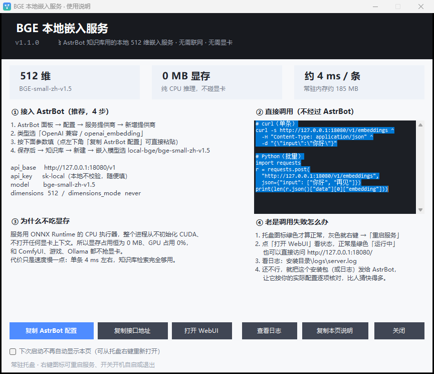
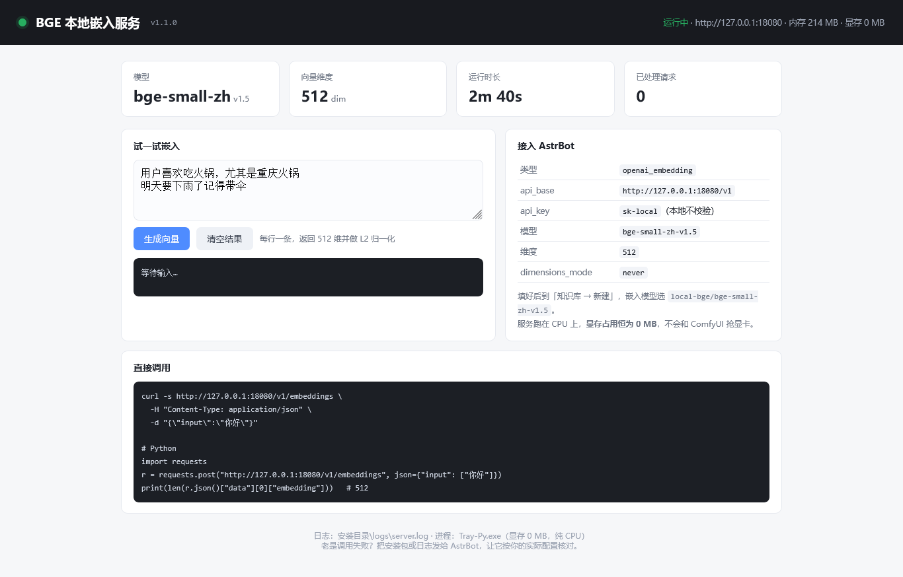

# BGE Local Embedding · Tray

A tiny, **CPU-only**, OpenAI-compatible embedding server for Windows — built to give
[AstrBot](https://github.com/AstrBotDevs/AstrBot) knowledge bases a local vectorizer that
**never touches your GPU**.

Runs **BGE-small-zh-v1.5** (512-dim, Chinese + English) on the CPU: **0 MB VRAM**,
~210 MB RAM, ~4 ms per sentence. Ships as a single one-click installer with a tray icon
and a built-in web console.

> 中文简介：给 AstrBot 知识库用的本地 512 维嵌入服务，纯 CPU、不吃显存，一键安装、托盘常驻，自带 WebUI。

---

## Why

Cloud embedding APIs cost money and leak your data; GPU embedding models compete with
ComfyUI / games for VRAM. This project packages a small, well-behaved Chinese embedding
model into a self-contained Windows service that:

- speaks the **OpenAI `/v1/embeddings`** protocol, so AstrBot (or any OpenAI-compatible
  client) can use it with zero code changes;
- runs **entirely on the CPU** — VRAM usage is a constant `0 MB`, GPU usage `0%`;
- installs **per-user, no admin rights**, no Python, no CUDA, no internet after install.

## Features

| | |
|---|---|
| **0 MB VRAM** | ONNX Runtime CPU execution provider; CUDA is never initialized |
| **512-dim vectors** | BGE-small-zh-v1.5, CLS pooling + L2 normalization |
| **~4 ms / text** | warm latency on a desktop CPU; batch of 5 ≈ 5 ms |
| **~210 MB RAM** | idle CPU usage is negligible |
| **One-click installer** | 92 MB single `.exe`, embeds the runtime and the model |
| **No dependencies** | no Python, no .NET download, no admin, works offline |
| **Tray app** | start / stop / restart, logs, autostart toggle, clean exit |
| **Built-in WebUI** | live stats, request counter, an embedding playground |
| **Optional autostart** | installer checkbox + tray menu toggle (HKCU, per-user) |
| **Easy uninstall** | Windows *Apps & features*, or `tray.exe --uninstall` |

## Screenshots

| First-run guide | Web console |
|---|---|
|  |  |

## Install

1. Download `BGE-Embedding-Setup.exe` from [Releases](../../releases).
2. Double-click it (unsigned → SmartScreen may warn: **More info → Run anyway**).
3. Pick an install folder (default `%LOCALAPPDATA%\BGE-Embedding`), optionally keep
   **Start with Windows** checked, click **Install**.

The tray icon turns **green** when the service is ready, **grey** when it is stopped.
The service listens only on `127.0.0.1:18080` — no firewall prompt.

Verify:

```powershell
curl.exe http://127.0.0.1:18080/health
# {"status":"ok","dim":512,"model":"bge-small-zh-v1.5","uptime_sec":12,
#  "requests":0,"avg_ms":0.0,"memory_mb":214,"device":"cpu","vram_mb":0}
```

## Connect to AstrBot

**WebUI → Configuration → Provider → Add provider**, type `openai_embedding`:

| Field | Value |
|---|---|
| `embedding_api_base` | `http://127.0.0.1:18080/v1` |
| `embedding_api_key` | `sk-local` (not validated locally) |
| `embedding_model` | `bge-small-zh-v1.5` |
| `embedding_dimensions` | `512` |
| `embedding_dimensions_mode` | `never` |

Or paste this into `cmd_config.json` under `provider_sources` / `provider`:

```json
{
  "provider": "local-bge",
  "type": "openai_embedding",
  "provider_type": "embedding",
  "embedding_api_base": "http://127.0.0.1:18080/v1",
  "embedding_api_key": "sk-local",
  "embedding_model": "bge-small-zh-v1.5",
  "embedding_dimensions": 512,
  "embedding_dimensions_mode": "never"
}
```

Then create a knowledge base and pick `local-bge/bge-small-zh-v1.5` as its embedding model.

> `embedding_dimensions_mode: "never"` matters: BGE's native size is 512, and sending a
> `dimensions` parameter would make AstrBot and the server disagree about vector width.

## API

Base URL: `http://127.0.0.1:18080`

| Method | Path | Description |
|---|---|---|
| `POST` | `/v1/embeddings` | OpenAI-compatible embeddings (string or array input) |
| `GET` | `/v1/models` | Lists `bge-small-zh-v1.5` |
| `GET` | `/health` | Status + live counters (memory, requests, avg latency) |
| `GET` | `/` | Built-in WebUI |

```bash
curl -s http://127.0.0.1:18080/v1/embeddings \
  -H "Content-Type: application/json" \
  -d '{"input": ["你好", "hello"], "model": "bge-small-zh-v1.5"}'
```

```json
{
  "object": "list",
  "data": [
    {"object": "embedding", "index": 0, "embedding": [0.0127, 0.0536, "... 512 values ..."]},
    {"object": "embedding", "index": 1, "embedding": ["..."]}
  ],
  "model": "bge-small-zh-v1.5",
  "usage": {"prompt_tokens": 12, "total_tokens": 12}
}
```

Python:

```python
import requests

r = requests.post("http://127.0.0.1:18080/v1/embeddings",
                  json={"input": ["用户喜欢吃火锅", "明天要下雨"]}, timeout=30)
vectors = [d["embedding"] for d in r.json()["data"]]   # 512 floats each, L2-normalized
```

## Performance

Measured on an i5-12600KF (Windows 11, CPU only):

| Metric | Value |
|---|---|
| Cold start (model load) | ~0.15 s |
| Single text, warm | 4.1 – 4.4 ms |
| Batch of 5 texts | 5.3 ms |
| Resident memory | 210 – 215 MB |
| VRAM | **0 MB** |
| GPU utilization | **0 %** |
| Installed size | ~207 MB |
| Installer size | 92.6 MB |

## How it works

```
BGE-small-zh-v1.5 (PyTorch)
        │  torch.onnx.export, opset 17, dynamic batch/seq
        ▼
   ONNX (fp32, 95 MB)  ──►  onnxruntime CPUExecutionProvider
        │                         │
        │                         ├─ tokenizers (HF, Rust) — identical tokenization
        │                         └─ stdlib ThreadingHTTPServer (no FastAPI/uvicorn)
        ▼
 embeddable CPython 3.12 + onnxruntime + tokenizers + numpy   (~113 MB)
```

- **No PyTorch at runtime.** The original service needed `torch` (≈1.4 GB RAM, 2.5 GB disk);
  the ONNX build uses CPU-only ONNX Runtime, cutting memory by ~6×.
- **fp32, not quantized.** Int8 dynamic quantization shrank the model to 24 MB but dropped
  cosine similarity against the reference model to ~0.958 — not acceptable for retrieval.
- **No config drift.** Tokenization uses the exact HuggingFace `tokenizer.json`, so vectors
  match the PyTorch output bit-for-bit (`cos = 1.000000` on our test set).

## Tray menu

```
BGE 嵌入服务 · 运行中（端口 18080）
Open WebUI / Copy endpoint
Restart service · View logs · Open install folder
Start with Windows  ☑
About · Quit
```

Double-clicking the icon opens the built-in guide. `Quit` stops the service and exits;
closing the window does not.

## Command line

```powershell
BGE-Embedding-Setup.exe /S                          # silent install (autostart + desktop shortcut)
BGE-Embedding-Setup.exe /S /D=D:\BGE                # custom directory
BGE-Embedding-Setup.exe /S --no-autostart           # silent, autostart off
BGE-Embedding-Setup.exe /S --no-desktop             # silent, no desktop shortcut

"...\BGE-Embedding\tray.exe" --uninstall --yes      # silent uninstall
```

## Files

```
%LOCALAPPDATA%\BGE-Embedding\
  tray.exe              tray shell + service supervisor (C# / .NET Framework)
  Tray-Py.exe           the worker process (renamed CPython, runs server.py)
  server\server.py      HTTP service (stdlib) + WebUI
  server\config.json    host / port / threads / max_length
  model\                bge-small-zh-v1.5.onnx + tokenizer.json
  runtime\              portable CPython 3.12 + deps
  logs\                 server.log, tray.log
```

## Troubleshooting

| Symptom | Fix |
|---|---|
| Tray icon stays grey | Right-click → **Restart service**; check `logs\server.log` |
| `Connection refused` on 18080 | Service not running, or `config.json` port changed |
| AstrBot: `dimension mismatch` | Set `embedding_dimensions: 512` and mode `never` |
| AstrBot: 404 / model not found | Model name must be exactly `bge-small-zh-v1.5` |
| Slow first request | Model is paging in; subsequent calls are ~4 ms |
| Still stuck | Open the WebUI, hit **Generate vectors**, and check `logs\server.log` — or hand the installer/log to AstrBot and let it audit your config |

## Limitations

- Windows 10/11 x64 only (the installer is a .NET Framework WinForms app).
- Model is tuned for **Chinese** primarily; English works but is not its strength.
- Max sequence length is **512 tokens** (long documents should be chunked; AstrBot does this).
- The installer is **unsigned** — SmartScreen will warn on first run.
- 512 dimensions; do not mix it with 1024-dim providers in the same knowledge base.

## Building

```powershell
# 1. export + quantize
python export_onnx.py

# 2. tray app (C# 5, .NET Framework)
csc /target:winexe /out:tray.exe /resource:on.ico,on.ico /resource:off.ico,off.ico `
    /win32icon:on.ico TrayApp.cs GuideForm.cs

# 3. installer (payload.zip embedded)
csc /target:winexe /out:BGE-Embedding-Setup.exe /resource:payload.zip,payload.zip `
    /win32icon:on.ico Setup.cs
```

## Credits

- Model: [BAAI/bge-small-zh-v1.5](https://huggingface.co/BAAI/bge-small-zh-v1.5) (MIT)
- Runtime: [ONNX Runtime](https://onnxruntime.ai/) · [HuggingFace tokenizers](https://github.com/huggingface/tokenizers)
- Target app: [AstrBot](https://github.com/AstrBotDevs/AstrBot)

## License

MIT for this project's code. The bundled model keeps its own license (MIT for
bge-small-zh-v1.5); ONNX Runtime and CPython keep their respective licenses.
