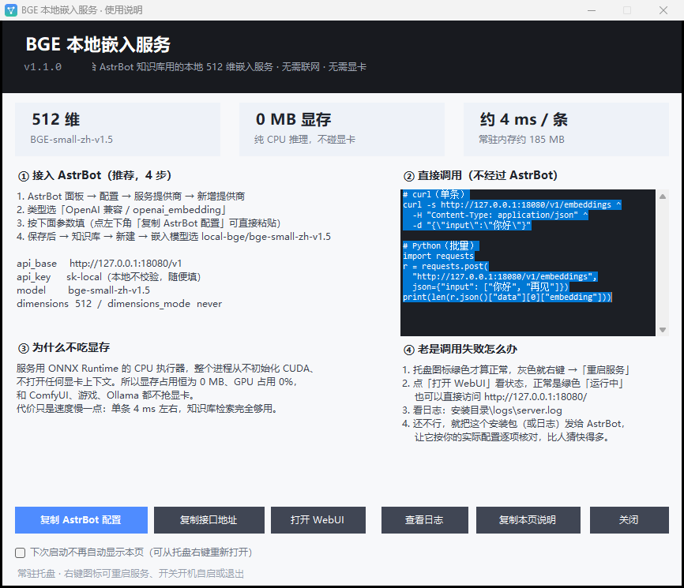
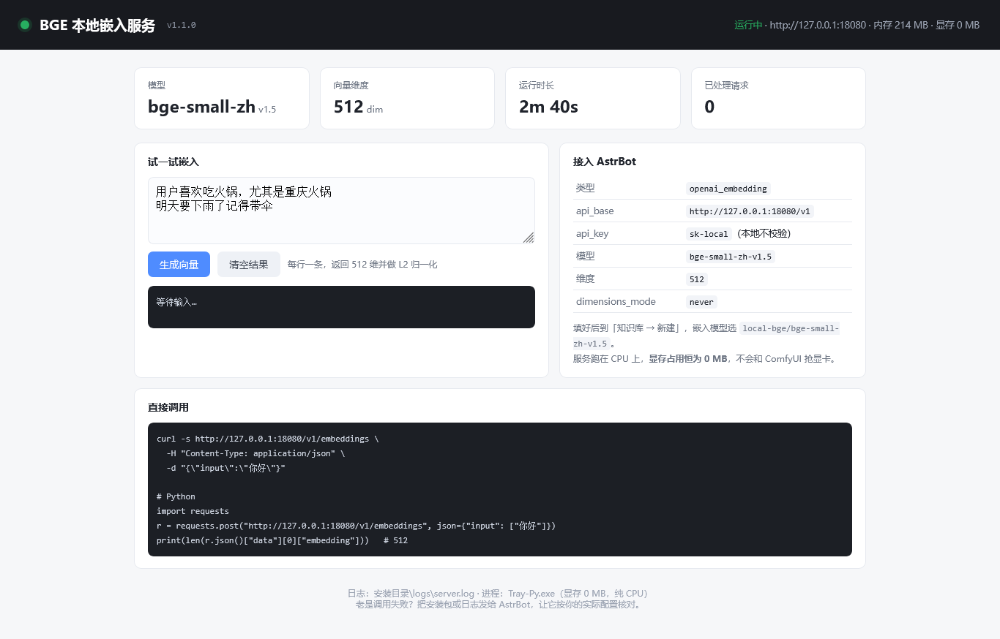

# BGE 本地嵌入服务 · 托盘版

**[English](README.md) · [简体中文](README.zh-CN.md)**

一个给 [AstrBot](https://github.com/AstrBotDevs/AstrBot) 知识库用的**纯 CPU**、OpenAI 兼容的本地嵌入服务。
跑 **BGE-small-zh-v1.5**（512 维，中英文），**显存占用恒为 0 MB**，内存约 210 MB，单条约 4 毫秒。
单个安装包一键装好，常驻系统托盘，自带本地 WebUI。

> 一句话：把「向量化」这件事从显卡上摘下来，交给 CPU 安静地做。

---

## 为什么做这个

云端 embedding API 要花钱、还会把知识库内容传出去；本地 GPU 模型又要和 ComfyUI、游戏抢显存。
这个项目把一个小而够用的中文嵌入模型打包成独立的 Windows 服务：

- 说 **OpenAI `/v1/embeddings`** 协议，AstrBot（或任何 OpenAI 兼容客户端）零改动接入；
- 全程 **CPU 推理**，显存占用恒为 `0 MB`、GPU 占用 `0%`；
- **按用户安装、不需要管理员权限**，不装 Python、不装 CUDA，装完离线可用。

## 特性

| | |
|---|---|
| **0 MB 显存** | ONNX Runtime CPU 执行器，进程从不初始化 CUDA |
| **512 维向量** | BGE-small-zh-v1.5，CLS 池化 + L2 归一化 |
| **约 4 ms / 条** | 桌面 CPU 上的热调用耗时；5 条批量约 5 ms |
| **约 210 MB 内存** | 空闲时几乎不占 CPU |
| **一键安装** | 92 MB 单文件 exe，运行时和模型全部内嵌 |
| **零依赖** | 不需要 Python / .NET 下载 / 管理员权限，装完不联网也能跑 |
| **托盘常驻** | 启动、停止、重启、看日志、开机自启开关、干净退出 |
| **自带 WebUI** | 实时状态、请求计数、在线试算嵌入 |
| **开机自启可选** | 安装界面勾选 + 托盘菜单随时开关（写 HKCU，按用户生效） |
| **卸载干净** | 设置 → 应用 → 卸载，或 `tray.exe --uninstall` |

## 截图

| 首次启动的说明窗口 | 本地 Web 控制台 |
|---|---|
|  |  |

## 安装

1. 从 [Releases](../../releases) 下载 `BGE-Embedding-Setup.exe`；
2. 双击运行（**未签名**，SmartScreen 会提示 →「更多信息」→「仍要运行」）；
3. 选择安装目录（默认 `%LOCALAPPDATA%\BGE-Embedding`），按需保留「开机自启」，点「安装」。

托盘图标 **绿色 = 服务正常**，**灰色 = 已停止**。服务只监听 `127.0.0.1:18080`，不会触发防火墙弹窗。

验证：

```powershell
curl.exe http://127.0.0.1:18080/health
# {"status":"ok","dim":512,"model":"bge-small-zh-v1.5","uptime_sec":12,
#  "requests":0,"avg_ms":0.0,"memory_mb":214,"device":"cpu","vram_mb":0}
```

## 接入 AstrBot

**面板 → 配置 → 服务提供商 → 新增**，类型选 `openai_embedding`：

| 字段 | 值 |
|---|---|
| `embedding_api_base` | `http://127.0.0.1:18080/v1` |
| `embedding_api_key` | `sk-local`（本地不校验） |
| `embedding_model` | `bge-small-zh-v1.5` |
| `embedding_dimensions` | `512` |
| `embedding_dimensions_mode` | `never` |

或直接粘贴到 `cmd_config.json` 的 `provider_sources` / `provider` 里：

```json
{
  "provider": "local-bge",
  "type": "openai_embedding",
  "provider_type": "embedding",
  "embedding_api_base": "http://127.0.0.1:18080/v1",
  "embedding_api_key": "sk-local",
  "embedding_model": "bge-small-zh-v1.5",
  "embedding_dimensions": 512,
  "embedding_dimensions_mode": "never"
}
```

然后「知识库 → 新建」，嵌入模型选 `local-bge/bge-small-zh-v1.5`。

> `embedding_dimensions_mode` 必须是 `never`：BGE 原生就是 512 维，如果向服务端发 `dimensions`
> 参数，AstrBot 记录的和实际返回的维度容易对不上（报「维度不匹配，实际 512，配置为 0」）。

## API

根地址：`http://127.0.0.1:18080`

| 方法 | 路径 | 说明 |
|---|---|---|
| `POST` | `/v1/embeddings` | OpenAI 兼容，`input` 支持字符串或数组 |
| `GET` | `/v1/models` | 返回 `bge-small-zh-v1.5` |
| `GET` | `/health` | 状态 + 实时计数（内存、请求数、平均耗时） |
| `GET` | `/` | 内置 WebUI |

```bash
curl -s http://127.0.0.1:18080/v1/embeddings \
  -H "Content-Type: application/json" \
  -d '{"input": ["你好", "hello"], "model": "bge-small-zh-v1.5"}'
```

```json
{
  "object": "list",
  "data": [
    {"object": "embedding", "index": 0, "embedding": [0.0127, 0.0536, "... 共 512 个 ..."]},
    {"object": "embedding", "index": 1, "embedding": ["..."]}
  ],
  "model": "bge-small-zh-v1.5",
  "usage": {"prompt_tokens": 12, "total_tokens": 12}
}
```

Python：

```python
import requests

r = requests.post("http://127.0.0.1:18080/v1/embeddings",
                  json={"input": ["用户喜欢吃火锅", "明天要下雨"]}, timeout=30)
vectors = [d["embedding"] for d in r.json()["data"]]   # 每条 512 维，已 L2 归一化
```

## 性能

实测环境：i5-12600KF / Windows 11 / 纯 CPU：

| 指标 | 数值 |
|---|---|
| 冷启动（加载模型） | 约 0.15 秒 |
| 单条文本（热） | 4.1 – 4.4 ms |
| 5 条批量 | 5.3 ms |
| 常驻内存 | 210 – 215 MB |
| 显存 | **0 MB** |
| GPU 占用 | **0 %** |
| 安装体积 | 约 207 MB |
| 安装包 | 92.6 MB |

## 实现原理

```
BGE-small-zh-v1.5 (PyTorch)
        │  torch.onnx.export，opset 17，动态 batch / seq
        ▼
   ONNX (fp32, 95 MB)  ──►  onnxruntime CPUExecutionProvider
        │                         │
        │                         ├─ tokenizers（HF，Rust 实现）——分词与原模型完全一致
        │                         └─ 标准库 ThreadingHTTPServer（不用 FastAPI / uvicorn）
        ▼
 便携版 CPython 3.12 + onnxruntime + tokenizers + numpy （约 113 MB）
```

三个关键取舍：

- **运行时不用 PyTorch**。原方案依赖 torch（约 1.4 GB 内存、2.5 GB 磁盘），换 ONNX 后内存降到约 1/6。
- **保持 fp32，没做 int8 量化**。动态量化能把模型压到 24 MB，但与原始模型的余弦相似度最低掉到 0.958，
  检索排序会受影响，不值当。
- **分词不自己实现**。直接用 HuggingFace 的 `tokenizer.json`，所以向量与 PyTorch 版本逐条一致
  （测试集上 `cos = 1.000000`）。

## 托盘菜单

```
BGE 嵌入服务 · 运行中（端口 18080）
打开 WebUI / 复制接口地址
重启服务 · 查看日志 · 打开安装目录
开机自启  ☑
关于 · 退出
```

双击托盘图标 = 打开「使用说明 / 接入指南」窗口（就是第一张截图）。
**「退出」** 会停止服务并退出进程；关闭说明窗口不影响服务。

## 命令行

```powershell
BGE-Embedding-Setup.exe /S                          # 静默安装（含自启 + 桌面快捷方式）
BGE-Embedding-Setup.exe /S /D=D:\BGE                # 指定安装目录
BGE-Embedding-Setup.exe /S --no-autostart           # 静默安装，不开自启
BGE-Embedding-Setup.exe /S --no-desktop             # 静默安装，不建桌面快捷方式

"...\BGE-Embedding\tray.exe" --uninstall --yes      # 静默卸载
```

## 目录结构

```
%LOCALAPPDATA%\BGE-Embedding\
  tray.exe              托盘程序 + 服务守护（C# / .NET Framework）
  Tray-Py.exe           实际干活的进程（重命名后的 CPython，跑 server.py）
  server\server.py      HTTP 服务（标准库）+ WebUI
  server\config.json    端口 / 线程 / 最大长度
  model\                bge-small-zh-v1.5.onnx + tokenizer.json
  runtime\              便携版 CPython 3.12 + 依赖
  logs\                 server.log、tray.log
```

## 常见问题

| 现象 | 处理 |
|---|---|
| 托盘图标一直是灰色 | 右键 →「重启服务」；看 `logs\server.log` |
| 提示 18080 连接被拒绝 | 服务没起来，或 `config.json` 里端口被改过 |
| AstrBot 报「维度不匹配」 | `embedding_dimensions: 512` + `embedding_dimensions_mode: never` |
| AstrBot 报 404 / 找不到模型 | 模型名必须是 `bge-small-zh-v1.5` |
| 第一次调用很慢 | 模型在换页，之后就恢复到 4 ms |
| 怎么也调不通 | 打开 WebUI 点「生成向量」自测，再看日志；实在不行把安装包或日志发给 AstrBot，让它按你的实际配置核对 |

## 限制

- 仅支持 **Windows 10/11 x64**（安装器是 .NET Framework WinForms 程序）。
- 模型以**中文**为主，英文可用但不是强项。
- 最大输入 **512 token**（长文档需要分块，AstrBot 会自动切）。
- 安装包**未签名**，首次运行会有 SmartScreen 提示。
- 固定 **512 维**，不要和 1024 维的提供商放进同一个知识库。

## 从源码构建

```powershell
# 1. 导出 ONNX 模型
python export_onnx.py

# 2. 编译托盘程序（C# 5 / .NET Framework）
csc /target:winexe /out:tray.exe /resource:on.ico,on.ico /resource:off.ico,off.ico `
    /win32icon:on.ico TrayApp.cs GuideForm.cs

# 3. 编译安装器（把 payload.zip 内嵌进去）
csc /target:winexe /out:BGE-Embedding-Setup.exe /resource:payload.zip,payload.zip `
    /win32icon:on.ico Setup.cs
```

## 致谢

- 模型：[BAAI/bge-small-zh-v1.5](https://huggingface.co/BAAI/bge-small-zh-v1.5)（MIT）
- 运行时：[ONNX Runtime](https://onnxruntime.ai/) · [HuggingFace tokenizers](https://github.com/huggingface/tokenizers)
- 目标应用：[AstrBot](https://github.com/AstrBotDevs/AstrBot)

## 许可证

本项目代码采用 MIT。随包附带的模型沿用其自身许可（bge-small-zh-v1.5 为 MIT）；
ONNX Runtime、CPython、NumPy 等组件各自保留原许可，详见 `LICENSE`。
